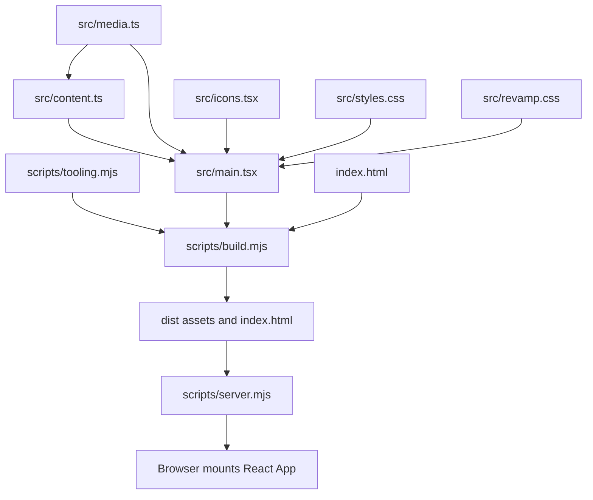

# CozySpace: detailed project guide

Analysis date: 2026-10-29. This guide describes the current local source snapshot. It is a static analysis, not a new browser test, security certification, or deployment review.

## What this project does

CozySpace is a single-page marketing reconstruction for home organization services. Visitors can browse seven room/service chapters, choose a featured photo, open a full-size photo viewer, read the approach, and choose a public contact destination. It does not implement user accounts, a booking system, payments, a database, or automatic message delivery.

The source uses React 19 and TypeScript. The current build uses esbuild rather than Vite. Public photographs and fonts are local files. The website can operate without external requests until a visitor deliberately follows a contact/social link.

## Start with these files

1. `README.md`: current run/edit instructions and reconstruction limitations.
2. `src/media.ts`: room/contact image paths and alt text.
3. `src/content.ts`: `Space`, brand/contact metadata, and ordered `spaces` records.
4. `src/main.tsx`: complete React composition and interaction owners.
5. `src/styles.css`, then `src/revamp.css`: base styles followed by intentional overrides.
6. `scripts/tooling.mjs`, `scripts/build.mjs`, and `scripts/server.mjs`: build/runtime boundary.
7. `UX-CONTRACT.md` and `inspection/REVAMP-REVIEW.md`: shared behavior and historical verification evidence.

## Architecture and execution



The module graph is small. `media.ts` supplies the image configuration, `content.ts` turns it into seven `Space` records, and `main.tsx` renders those records. Static CSS imports are resolved by esbuild into the generated CSS asset; the structural import map covers supported code imports and is not a complete stylesheet/asset graph.

At browser startup, `createRoot` mounts `App` in `#root` inside `React.StrictMode`. `App` renders the skip link, header, main sections, footer, shared contact dialog, and conditional photo gallery. There is no client router: navigation uses document fragment anchors. Room IDs therefore form an internal navigation contract.

## State ownership and interaction flows

| State or behavior | Owner | Flow |
| --- | --- | --- |
| Mobile navigation open/closed | `Header` local state | Toggle changes the menu and `aria-expanded`; selecting a link, outside pointer events, Escape, or a desktop breakpoint dismisses it. Escape restores menu-button focus. |
| Featured hero photo | `Hero` local `active` index | A room-selector button updates the index; the image class and button pressed state reflect the same value. |
| Gallery selection | `App` nullable `gallery` index | A room chapter passes its index to `setGallery`; non-null selection mounts `PhotoGallery`. |
| Gallery modal lifecycle | `PhotoGallery` effect and native dialog | Opening calls `showModal`, locks body scroll and captures the trigger; unmount closes the dialog, removes scroll lock and restores trigger focus. |
| Gallery navigation | `PhotoGallery.move` | Previous/next and arrow keys wrap modulo `spaces.length`; Escape closes through the parent callback. Tab/Shift+Tab wrap among modal buttons. |
| Contact modal | `App` dialog ref plus `ContactDialog` | Shared contact actions call `showModal`; the dialog displays the configured WhatsApp links and contains focus. Close/backdrop handling removes scroll lock. |
| Contact/social destination | `content` metadata | Links open a destination only after a visitor chooses one; the site does not send the message itself. |

The gallery and contact dialog are separate components. Both use `dialog-open` on `document.body`. The application does not model a general stack of simultaneously open overlays; when changing overlay behavior, inspect both cleanup paths together.

## Content model

`Space` declares `id`, `name`, `heading`, `description`, `detail`, `image`, and `alt`. The seven records cover kitchen, wardrobe, bathroom, laundry, storage room, office room, and move-ins. Their array order controls hero selectors, chapter order, next-room links, and gallery cycling. Adding/reordering a record affects all those consumers.

`media` is the image source of truth; browser URLs omit the `public` prefix. `Contact` uses the configured contact image with a kitchen fallback. `content` holds brand text, Instagram URL, and contact choices. These are editable public marketing values, not a runtime credential store.

## Component responsibilities

`Header` owns navigation dismissal. `Hero` owns photo choice. `Story` and `Philosophy` render static narrative. `Services` renders the index and maps `SpaceChapter`; each chapter contains a photo action, next anchor and inquiry action. `Contact` renders the final call-to-action. `Footer` renders public destinations. `ContactDialog` and `PhotoGallery` own modal semantics. Small `Eyebrow` and `SectionLabel` components are presentation helpers; the currently accepted `SectionLabel.index` prop is not displayed. `icons.tsx` contains small SVG components instead of a third-party icon package.

## Build, preview, and tooling boundaries

`scripts/tooling.mjs` searches for a complete existing package directory in this project, then the sibling `solution-doc-chat/node_modules`. It requires esbuild, React and TypeScript to be present. It does not install or download packages. This sibling fallback is a portability constraint: moving just this folder to another machine may require an approved dependency setup.

`scripts/build.mjs` creates `dist/assets`, copies `public` into `dist`, bundles `src/main.tsx` into minified production assets, and rewrites the source script tag in `index.html` to the generated JS/CSS. `scripts/typecheck.mjs` separately constructs a strict TypeScript program with the existing React type paths. A successful bundle alone is not a substitute for a successful type check.

`scripts/server.mjs` serves `dist` on `127.0.0.1`, normally port 5175. It builds only when `dist/index.html` is absent, so restarting an existing build does not automatically incorporate edited source. The preview marker `/__cozyspace_preview` identifies an already-running instance; unrelated port collisions try subsequent ports, up to ten beyond the chosen starting port. It validates `PORT`, rejects paths outside its root and returns an ordinary 404 for missing assets. This is a local preview server, not a claim of production hosting readiness.

## Commands and evidence

The commands below come from the source/manifest and were **not executed as application checks during this analysis**:

```powershell
npm run typecheck
npm run build
npm run dev
# In another terminal with the local site available:
node scripts/verify.cjs
node scripts/server-check.mjs
```

`npm run build` invokes typecheck first. `dev`, `start`, and `preview` all point to the local server. `Start CozySpace.cmd` is the Windows launcher.

`scripts/verify.cjs` expects the local site at port 5175 and uses the sibling Playwright installation. It checks selectors, anchors, gallery focus/keys, contact destination configuration, multiple widths, reduced motion and offline interaction. Some historical inspection helpers use installed Chrome and configurable module/URL paths; inspect their inputs before running them. `inspection/fetch-assets.mjs` and `inspection/inspect-reference.mjs` access the public reference and were deliberately not run.

`inspection/REVAMP-REVIEW.md` records earlier passing checks; that is historical evidence belonging to the recorded revision and environment. This analysis verified graph schema, file coverage, graph references and fingerprint creation. It did not establish current browser correctness, physical-device behavior, independent QA/security approval, asset publication rights, or message delivery.

## Where to make changes

| Desired change | Starting point | Recheck |
| --- | --- | --- |
| Replace images or alt text | `src/media.ts`, `public/media/` | Every hero/gallery/chapter consumer; build asset paths. |
| Change service order/copy | `src/content.ts` | Fragment IDs, direct index, next links and gallery order. |
| Change interaction/focus | `src/main.tsx` | Keyboard, backdrop, dismissal and cleanup for both dialogs. |
| Change visual spacing/type | Base CSS then refinement CSS | Cascade order, seven viewport widths, focus and reduced motion. |
| Change local launcher/build | `scripts/` | Fresh build, stale-build behavior and occupied-port preservation. |

## Graph and scope

Open `.ua/knowledge-graph.json` through Understand Anything. The graph has six layers and a six-step tour. `.ua/coverage-report.json` records exact eligible-file coverage, parser skips and limitations; `.ua/fingerprints.json` supports later incremental updates. Auto-update is disabled and no Git hooks were installed.

The inventory excludes secrets/local private data, dependencies, built output, binary media and large generated capture/audit JSON. Lightweight reference scripts and review Markdown remain represented. Each eligible file has a graph node; symbols are derived from the bundled structural parser and enriched with source-grounded descriptions. Anonymous callbacks, CSS selectors, every expression and external package internals are not separate graph nodes. The source-linked catalogue below provides additional detail without pretending that static analysis proves every runtime behavior.

Rollback for this analysis: remove only this new guide and newly generated `.ua` analysis artifacts after reviewing the diff; application source was not changed. Preserve `.ua/.understandignore` if the approved exclusions should remain available.


## Complete eligible-file catalogue

Each row corresponds to an actual scanned file and a file-level graph node. Links are relative to this project.

| File | Role |
| --- | --- |
| [DESIGN.md](DESIGN.md) (101 lines) | Records brand direction, typography, colors, layout and accessibility decisions that guide the rendered site. |
| [MEDIA-GUIDE.md](MEDIA-GUIDE.md) (36 lines) | Explains replaceable local image/video slots, file locations, recommended dimensions and rebuild steps. |
| [README.md](README.md) (74 lines) | Explains local startup, editable source boundaries, integration limitations, verification commands and recovery. |
| [Start CozySpace.cmd](Start%20CozySpace.cmd) (6 lines) | Starts the local preview server from the project directory using Node; does not install packages. |
| [TASKS.md](TASKS.md) (17 lines) | Records task history, completed changes and remaining limitations; these historical checks are not rerun by this analysis. |
| [UX-CONTRACT.md](UX-CONTRACT.md) (16 lines) | Defines canonical owners and consistent navigation, form, feedback, media and accessibility behavior. |
| [index.html](index.html) (18 lines) | Provides document metadata and the root DOM mount used by the React browser entry point. |
| [inspection/FINDINGS.md](inspection/FINDINGS.md) (25 lines) | Records public-reference inspection findings, implementation decisions, evidence limitations and historical recovery notes. |
| [inspection/REVAMP-REVIEW.md](inspection/REVAMP-REVIEW.md) (45 lines) | Records October 29 revamp changes, historical browser/build evidence, tooling reuse, open review gates and rollback. |
| [inspection/REVIEW.md](inspection/REVIEW.md) (25 lines) | Records historical local reconstruction checks and the scope those checks did not establish. |
| [inspection/fetch-assets.mjs](inspection/fetch-assets.mjs) (28 lines) | Downloads public reference assets into the local project; not executed during analysis because it accesses the network. |
| [inspection/inspect-reference.mjs](inspection/inspect-reference.mjs) (53 lines) | Uses browser automation to inspect the public reference and save visual/DOM observations; not run here. |
| [inspection/qa-check.mjs](inspection/qa-check.mjs) (24 lines) | Contains local browser QA assertions for the reconstruction; source was analyzed without launching a browser. |
| [inspection/verify-local.mjs](inspection/verify-local.mjs) (121 lines) | Checks local rendered structure, keyboard behavior, responsive views and media using browser automation. |
| [package.json](package.json) (26 lines) | Defines Node runtime requirements and the documented startup/build/check commands; no application execution is performed here. |
| [public/fonts/fonts.css](public/fonts/fonts.css) (42 lines) | Declares locally served Manrope and Libre Caslon Display font faces and weights. |
| [public/media/README.md](public/media/README.md) (7 lines) | Documents where licensed replacement media belongs and how browser URLs map to the public directory. |
| [scripts/build.mjs](scripts/build.mjs) (10 lines) | Copies public assets, bundles src/main.tsx into minified production JS/CSS with existing esbuild, and rewrites the HTML entry to dist assets. |
| [scripts/capture.cjs](scripts/capture.cjs) (3 lines) | Captures local preview screenshots using the sibling Playwright installation. |
| [scripts/server-check.mjs](scripts/server-check.mjs) (6 lines) | Creates synthetic loopback servers to verify a busy unrelated port is preserved and preview moves to the next port. |
| [scripts/server.mjs](scripts/server.mjs) (13 lines) | Serves the existing dist build on loopback port 5175 by default, builds only if missing, checks its preview marker and retries occupied ports. |
| [scripts/tooling.mjs](scripts/tooling.mjs) (8 lines) | Finds a complete local or sibling solution-doc-chat toolchain and exposes a createRequire resolver without downloading packages. |
| [scripts/typecheck.mjs](scripts/typecheck.mjs) (9 lines) | Loads the TypeScript configuration, resolves existing React types and reports compiler diagnostics without bundling. |
| [scripts/verify.cjs](scripts/verify.cjs) (37 lines) | Exercises seven room selectors, anchors, photo dialog keyboard/focus behavior, contacts, responsive layouts and offline interactions. |
| [src/content.ts](src/content.ts) (68 lines) | Defines the Space type, public brand/contact metadata and seven ordered room/service records derived from the media map. |
| [src/icons.tsx](src/icons.tsx) (9 lines) | Implements the shared SVG wrapper and six reusable icons without an external icon dependency. |
| [src/main.tsx](src/main.tsx) (203 lines) | Mounts the React app and defines navigation, hero selectors, room chapters, contact dialog and keyboard-accessible full-size photo viewer. |
| [src/media.ts](src/media.ts) (14 lines) | Centralizes local room/contact image URLs and alternative text so all image consumers share one configuration. |
| [src/revamp.css](src/revamp.css) (63 lines) | Overrides the base styles for the named room selectors, direct index, clearer chapters and full-size photo dialog. |
| [src/styles.css](src/styles.css) (261 lines) | Defines the base palette, typography, photographic page sections, responsive layouts, focus states and reduced-motion behavior. |
| [tsconfig.json](tsconfig.json) (15 lines) | Configures strict TypeScript and JSX compilation for the React source. |

## Named symbol catalogue

This catalogue preserves all named functions and class records returned by the bundled structural extractor, including small helpers that do not meet the graph significance threshold. Line ranges refer to this analyzed source snapshot and may shift after edits. Anonymous callbacks and exported data constants are not function declarations.

| Source | Symbol | Lines | Exported | Role when represented in graph |
| --- | --- | --- | --- | --- |
| [src/icons.tsx](src/icons.tsx) | `Icon` | 3–3 | No | Small local helper; inspect its source context for the complete expression. |
| [src/icons.tsx](src/icons.tsx) | `ArrowDown` | 4–4 | Yes | Renders a downward arrow SVG. |
| [src/icons.tsx](src/icons.tsx) | `ArrowDownRight` | 5–5 | Yes | Renders a diagonal down-right arrow SVG. |
| [src/icons.tsx](src/icons.tsx) | `ArrowUpRight` | 6–6 | Yes | Renders a diagonal up-right arrow SVG. |
| [src/icons.tsx](src/icons.tsx) | `Menu` | 7–7 | Yes | Renders the hamburger navigation SVG. |
| [src/icons.tsx](src/icons.tsx) | `X` | 8–8 | Yes | Renders a close SVG. |
| [src/icons.tsx](src/icons.tsx) | `MessageCircle` | 9–9 | Yes | Renders the contact speech-bubble SVG. |
| [src/main.tsx](src/main.tsx) | `Eyebrow` | 15–17 | No | Renders a short eyebrow label and decorative marker. |
| [src/main.tsx](src/main.tsx) | `SectionLabel` | 19–21 | No | Renders the reusable section label; the index prop is accepted but not displayed. |
| [src/main.tsx](src/main.tsx) | `Header` | 23–50 | No | Owns mobile menu state and closes it on selection, Escape, outside pointer events or a desktop breakpoint. |
| [src/main.tsx](src/main.tsx) | `Hero` | 52–70 | No | Owns the selected room photo index and renders all seven named selectors with pressed state. |
| [src/main.tsx](src/main.tsx) | `Story` | 72–81 | No | Renders the introductory home-organization narrative. |
| [src/main.tsx](src/main.tsx) | `SpaceChapter` | 83–105 | No | Renders one room image, description, next-room anchor, photo action and shared inquiry action. |
| [src/main.tsx](src/main.tsx) | `Services` | 107–117 | No | Renders the direct room index and maps all room records into chapter components. |
| [src/main.tsx](src/main.tsx) | `Philosophy` | 119–132 | No | Renders approach principles and the shared contact action. |
| [src/main.tsx](src/main.tsx) | `Contact` | 134–145 | No | Renders the final photographic contact call-to-action using configured media. |
| [src/main.tsx](src/main.tsx) | `ContactDialog` | 147–168 | No | Renders WhatsApp options in a native dialog and wraps Tab focus while handling backdrop dismissal. |
| [src/main.tsx](src/main.tsx) | `Footer` | 170–176 | No | Renders brand, Instagram and public WhatsApp links without automatically opening or sending messages. |
| [src/main.tsx](src/main.tsx) | `PhotoGallery` | 178–187 | No | Opens a native modal for the selected room; wraps next/previous indices, handles arrows/Escape/Tab, locks scroll and restores trigger focus. |
| [src/main.tsx](src/main.tsx) | `App` | 189–201 | No | Owns contact-dialog ref and selected gallery index; composes all page sections and mounts the dialogs. |
| [inspection/verify-local.mjs](inspection/verify-local.mjs) | `record` | 8–8 | No | Small local helper; inspect its source context for the complete expression. |

## Coverage result

- Eligible files represented: **31/31**.
- Graph nodes: **50** (20 file, 19 function, 9 document, 2 config).
- Graph edges: **60**; layers: **6**; guided steps: **6**.
- Core KnowledgeGraphSchema validation, unique IDs, existing edge/layer/tour references and exactly-one-layer file assignment passed.
- Bundled fingerprint baseline succeeded for all **31** eligible files before metadata was saved.
- The merge helper removed 3 path-convention test associations that did not satisfy its canonical test-file recognition. The guide therefore describes the actual check scripts explicitly; missing tested_by edges do not mean those scripts do not exist.
- Unsupported non-code formats receive file-level descriptions and conservative content fingerprints; no unsupported parser is represented as an execution trace.
